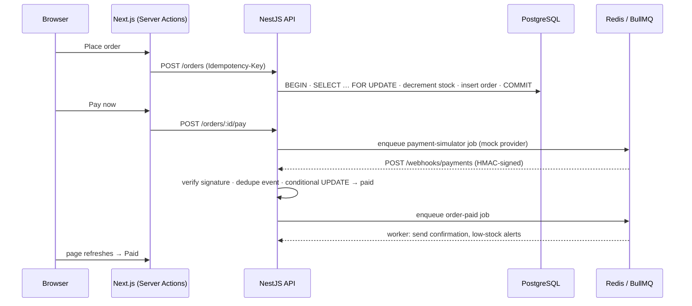

# TradeFlow

A **multi-tenant B2B wholesale ordering platform**. Suppliers (tenants) manage a product catalog and their team, and business buyers place orders against live stock. Payments are confirmed asynchronously through signed webhooks, and follow-up work runs in background jobs.

| Layer    | Stack                                                                                                  |
| -------- | ------------------------------------------------------------------------------------------------------ |
| API      | **NestJS 12** (Express adapter), TypeScript, **PostgreSQL + TypeORM** (migrations), **Redis + BullMQ** |
| Web      | **Next.js 16** (App Router, Server Components, Server Actions), React 19, Tailwind CSS                  |
| Tooling  | Docker Compose, GitHub Actions, Vitest + Supertest, Swagger/OpenAPI, Pino structured logging           |

---

## Quick start

> Full instructions, configuration and troubleshooting are in **[how-to-run.md](how-to-run.md)**.

**Option A — everything in Docker (one command):**

```bash
docker compose --profile app up -d --build
docker compose --profile app run --rm backend node dist/database/seed.js
```

Open http://localhost:3000. The API runs on http://localhost:4000, with docs at http://localhost:4000/api/docs.

**Option B — local development (hot reload):**

```bash
docker compose up -d                 # PostgreSQL (port 5433) + Redis (port 6379)

cd backend
cp .env.example .env
npm install
npm run build && npm run migration:run && npm run seed
npm run start:dev                    # http://localhost:4000

cd ../frontend
cp .env.example .env.local
npm install
npm run dev                          # http://localhost:3000
```

> Uses **npm 11** (pinned via `packageManager`). Run `npm i -g npm@11` if `npm ci` complains about the lockfile.

### Demo accounts

All accounts use the password `Password123!`. The login page has click-to-fill buttons for each one.

| Email                  | Role  | Tenant             |
| ---------------------- | ----- | ------------------ |
| `admin@everest.test`   | Admin | Everest Wholesale  |
| `staff@everest.test`   | Staff | Everest Wholesale  |
| `buyer@everest.test`   | Buyer | Everest Wholesale  |
| `admin@annapurna.test` | Admin | Annapurna Supplies |

**Suggested 2-minute tour:**
1. Sign in as the **buyer**. Go to Products, enter quantities, place an order, and click **Pay now**. The page shows *payment processing* until the webhook arrives about 2 seconds later, then flips to **Paid** on its own.
2. Sign in as the **admin**. Check the revenue stats, then mark the order **fulfilled**, add a product, and invite a teammate.
3. Sign in as **Annapurna's admin** and open the Everest order URL. You get a 404, because tenants are isolated.

---

## How the order → payment flow works



---

## Where each job requirement is covered

| Requirement | Where to look |
| --- | --- |
| **RESTful APIs** | Feature modules in [`backend/src`](backend/src): auth, users, products, orders, webhooks, health. DTO validation, pagination, correct status codes (201/204/400/401/403/404/409/429), Swagger at `/api/docs`. |
| **Multi-tenant SaaS** | Every tenant-owned row has `tenant_id`. The tenant comes from the verified JWT, never from client input, and every query is scoped by it ([`orders.service.ts`](backend/src/orders/orders.service.ts) `scope()`). |
| **PostgreSQL + TypeORM, production-safe migrations** | `synchronize: false`. The [initial migration](backend/src/database/migrations) is generated from entities and reviewed. [`AddOrdersTenantCreatedAtIndex`](backend/src/database/migrations/1790701700000-AddOrdersTenantCreatedAtIndex.ts) uses `CREATE INDEX CONCURRENTLY` with `transaction = false`, so there's no write lock on a busy table. CI fails if entities change without a migration (`migration:check`). |
| **Data integrity under concurrency** | Stock is reserved inside a transaction with pessimistic row locks, taken in a consistent order to avoid deadlocks. Order creation is idempotent via an `Idempotency-Key` header plus a unique index. Status changes are conditional `UPDATE … WHERE status = …`. |
| **Redis + BullMQ workers** | [`orders.processor.ts`](backend/src/orders/orders.processor.ts) handles post-payment work. [`payment-simulator.processor.ts`](backend/src/payments/payment-simulator.processor.ts) delivers webhooks. Retries use exponential backoff, and job IDs are deterministic so jobs aren't duplicated. |
| **Third-party integrations & webhooks** | [`PaymentGateway`](backend/src/payments/payment-gateway.interface.ts) interface with a mock provider. Inbound webhooks: HMAC-SHA256 verification over the **raw body** with constant-time comparison, and event deduplication in `webhook_events`. |
| **Auth & security (JWT, cookies, RBAC)** | JWT in an **httpOnly, SameSite** cookie; the browser never sees the token. A global `AuthGuard` with `@Public()` opt-out and `RolesGuard` with `@Roles()`. Also bcrypt, Helmet, validation whitelisting, rate limiting (sign-in keyed by IP + email), and a generic "invalid email or password" message. |
| **DI & SOLID** | Callers depend on the `PAYMENT_GATEWAY` token, not a concrete class, so Stripe or eSewa can be swapped in via `useClass` without touching the orders code. Modules have one job each, with no circular imports. |
| **Observability** | Pino structured JSON logs with a request ID (reuses an incoming `x-request-id`). Cookie and authorization headers are redacted. `/api/health` checks the DB and Redis and reports queue depth. |
| **Testing** | Vitest unit tests (services, guards, signatures) and **e2e tests against real Postgres + Redis** with Supertest. The full UI flow was also verified in a headless browser. |
| **Docker & CI/CD** | Multi-stage Dockerfiles (Next.js `standalone` output, non-root user). [GitHub Actions](.github/workflows/ci.yml): lint → typecheck → unit → migrate → drift check → e2e → image build. |

### Frontend (Next.js) highlights
- **Server Components** fetch data on the server. **Server Actions** handle mutations. The browser never talks to the API directly, so there's no CORS setup and no token in JavaScript.
- `proxy.ts` (Next 16's renamed middleware) does an *optimistic* redirect for signed-out users. The API still enforces auth on every request.
- `useActionState` forms with inline errors, `useFormStatus` pending buttons, `loading.tsx` / `error.tsx` boundaries, and a responsive layout.

---

## Project structure

```
backend/src
├── auth/          register, login (cookie), me · global guards
├── users/         team & buyer management (admin only)
├── products/      catalog CRUD, search, soft delete
├── orders/        stock reservation, payment, fulfilment · BullMQ processor
├── payments/      PaymentGateway interface, mock provider, webhook signing
├── webhooks/      signed inbound webhook endpoint + dedupe log
├── health/        DB + Redis health check
├── common/        decorators, guards, DTOs, enums
└── database/      data source, migrations, seed

frontend/src
├── app/(auth)/    login, register
├── app/dashboard/ overview, products, orders, team
├── app/actions/   Server Actions (auth, products, orders, users)
├── lib/           server-only API client, session, formatting, types
└── proxy.ts       optimistic auth redirect
```

## Useful commands

| Command (in `backend/`) | Purpose |
| --- | --- |
| `npm run migration:generate -- src/database/migrations/Name` | Generate a migration from entity changes |
| `npm run migration:run` / `migration:revert` | Apply / roll back migrations |
| `npm run migration:check` | Fail if entities and schema differ |
| `npm test` / `npm run test:e2e` | Unit tests / e2e tests (needs `docker compose up -d`) |

## What I'd add next
- Refresh-token rotation and per-tenant API keys for server-to-server integrations
- Outbound tenant webhooks (order events) with a delivery log and replay
- Sentry, plus OpenTelemetry traces that carry the request ID into queue jobs
- Postgres row-level security as a second layer of tenant isolation
